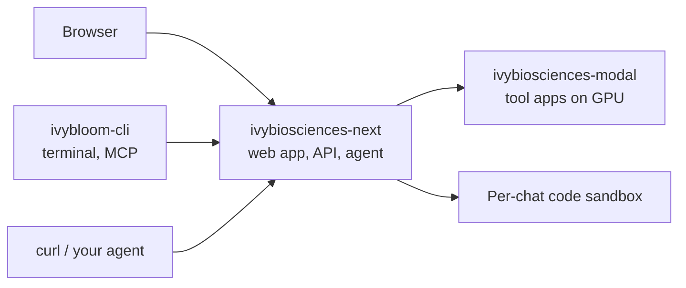

<div align="center">

<picture>
  <source media="(prefers-color-scheme: dark)" srcset="assets/leaf-on-dark.png">
  
</picture>

# Ivy Biosciences

**Fold, dock, screen and plan the synthesis, in one question.**

[Website](https://www.ivybiosciences.com) · [Docs](https://www.ivybiosciences.com/docs) · [Models](https://www.ivybiosciences.com/models) · [Pricing](https://www.ivybiosciences.com/pricing) · [Security](https://www.ivybiosciences.com/security) · [Pleach](https://www.getpleach.com)

[](#license)
[](https://www.npmjs.com/package/@ivybiosciences/ivybloom-cli)


</div>

## .bloom\*

**.bloom\*** is 500+ biomedical tools and 75+ databases behind one account. Ask **Ivy**, the agent, and it plans the run, submits each job and feeds its output into the next. Or skip the planner and submit a single tool job yourself.

Every result names the tool, the parameters and the run that produced it. You leave with what the run made: a structure, a ranked table, an export.

## Four ways in

The same run, whichever way in.

**Web.** Ask Ivy at [ivybiosciences.com](https://www.ivybiosciences.com). No account is needed to start: guests get up to $1 of compute per day.

**Terminal.** `ivybloom` is a chat TUI, a job runner and a batch tool. It needs a free account.

```bash
npm install -g @ivybiosciences/ivybloom-cli && ivybloom auth login
ivybloom run esmfold protein_sequence=MKFLILLFNILCLFPVLAADNH --wait   # one job
ivybloom batch submit jobs.yaml                                        # many jobs
ivybloom                                                               # chat with Ivy
```

**HTTP.** Ask Ivy with one `curl`, no key required on the guest tier:

```bash
curl -N https://www.ivybiosciences.com/api/v1/orchestrate \
  -H 'Content-Type: application/json' \
  -d '{"prompt":"find recent papers on EGFR L858R resistance","stream":true}'
```

Or submit one tool job directly with an API key:

```bash
curl -X POST https://www.ivybiosciences.com/api/v1/jobs \
  -H "Authorization: Bearer $IVY_API_KEY" -H "Content-Type: application/json" \
  -d '{"tool_name":"esmfold","tool_input_parameters":{"protein_sequence":"MKFLILLFNILCLFPVLAADNH"}}'
```

**Your agent.** Any MCP client can use the CLI as a server:

```json
{ "mcpServers": { "ivybloom": { "command": "ivybloom", "args": ["mcp", "serve"] } } }
```

Agents without MCP can read [`/llms.txt`](https://www.ivybiosciences.com/llms.txt), [`/llms-full.txt`](https://www.ivybiosciences.com/llms-full.txt) or the installable [`SKILL.md`](https://www.ivybiosciences.com/SKILL.md).

## What it computes

| Domain | What it does | Examples |
| ------ | ------------ | -------- |
| **Explore** | Search literature, databases and public repositories | PubMed, ChEMBL, ClinVar |
| **Analyze** | Screen compounds, predict properties, assess safety | ADMET-AI, RDKit, safety screening |
| **Predict** | Fold proteins, dock molecules, simulate binding | ESMFold, Boltz-2, DiffDock, OpenMM |
| **Design** | Generate molecules, engineer proteins, design biologics | Fragment chemistry, ThermoMPNN, antibody annotation |
| **Omics and clinical** | Analyze genomes, transcriptomes and clinical data | BLAST, CellTypist, bulk RNA-seq, CRISPR guide design |
| **Reports and automation** | Generate passports, export data, automate lab work | AiZynthFinder routes, Opentrons protocols, patent landscapes |

Browse the full catalog at [ivybiosciences.com/models](https://www.ivybiosciences.com/models).

## A record you can check

Signed-in runs from the web app, the terminal, `curl` or MCP all write to the same hash-chained record. Edit a row and the chain breaks at the verifier. It detects modification; it does not prevent it, and it is not access control.

You also pick the model: Anthropic directly or through OpenRouter, across the model families your plan includes, or bring your own key.

## Repositories



| Repository | What it is | Built with |
| ---------- | ---------- | ---------- |
| [**ivybiosciences-next**](https://github.com/ivybiosciences/ivybiosciences-next) | The web app, the public API, and Ivy: the agent that picks and chains tools. Includes a Mol\* 3D viewer and a canvas of result cards. The `@pleach/*` runtime is developed here. | TypeScript, Next.js, React |
| [**ivybiosciences-modal**](https://github.com/ivybiosciences/ivybiosciences-modal) | The compute backend: one serverless app per scientific tool, the job orchestrator, and the isolated code sandbox each chat gets. Scales to zero when idle. | Python, FastAPI, Modal |
| [**ivybloom-cli**](https://github.com/ivybiosciences/ivybloom-cli) | `ivybloom`: chat TUI, `run` / `jobs` / `batch` commands, JSON envelopes for CI, and an MCP server with selectable toolsets. macOS, Linux and Windows. | Go |

Organizations that need data sovereignty or their own compute can self-host. Start with the [Self-Hosting Guide](https://github.com/ivybiosciences/ivybiosciences-next/blob/vine/docs/self-hosting/README.md).

## Pleach

The agent runtime inside Ivy is being carved out as [**Pleach**](https://www.getpleach.com) (`@pleach/*`): an agent runtime for regulated work, usable in any AI application.

Pleach writes every model call as a typed, hash-chained, replayable row in your own database. Around that row it provides:

- **Tamper evidence.** Each row carries the hash of the one before it, and `verifyChain` names the first row that does not match.
- **Trusted time.** The chain can be anchored to an RFC 3161 time-stamp authority you choose.
- **Human approval.** A tool can wait for a person, and the decision is written as a chained row.
- **Replay.** A recorded turn is re-served from the record, and the first request that drifts is named.
- **Family-locked routing.** A session stays inside the model family it started in.
- **Cost rollup.** Every subagent call carries the turn that caused it, so spend totals by root turn in one query.

These are mechanisms, not a certification. Packages include `@pleach/core`, `react`, `recipes`, `gateway`, `compliance`, `eval`, `replay`, `observe`, `mcp`, `langchain`, `sandbox` and `coding-agent`. They are **not on npm yet**; some names are reserved with `0.0.1` placeholders. Documentation and package status are at [getpleach.com/docs](https://www.getpleach.com/docs).

## License

All Ivy Biosciences and Pleach code is licensed under **FSL-1.1-Apache-2.0**, the [Functional Source License](https://fsl.software) with an Apache 2.0 future license. Each release converts to Apache 2.0 two years after it is published.

- **You can** self-host for your organization, use it internally for research, build integrations, and run it as a CRO serving clients.
- **You cannot** offer it as a competing hosted service or resell API access, until a release converts.

Individual compute apps wrap upstream models that may carry their own licenses. The `LICENSE.md` in each repository has the full terms.

## Contact

| | |
| --- | --- |
| **Support** | [support@ivybiosciences.com](mailto:support@ivybiosciences.com) |
| **Enterprise and self-hosting** | [admin@ivybiosciences.com](mailto:admin@ivybiosciences.com) |
| **Security reports** | [security@ivybiosciences.com](mailto:security@ivybiosciences.com). Please do not open a public issue for a vulnerability. |
| **Updates** | [@ivybiosciences on X](https://x.com/ivybiosciences) |

<div align="center">
<sub>Copyright 2024-2026 Ivy Biosciences, Inc.</sub>
</div>
